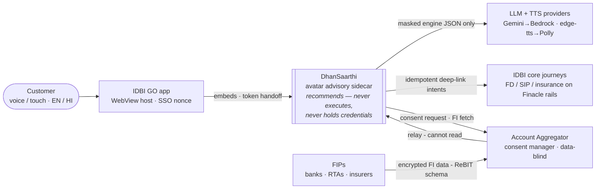
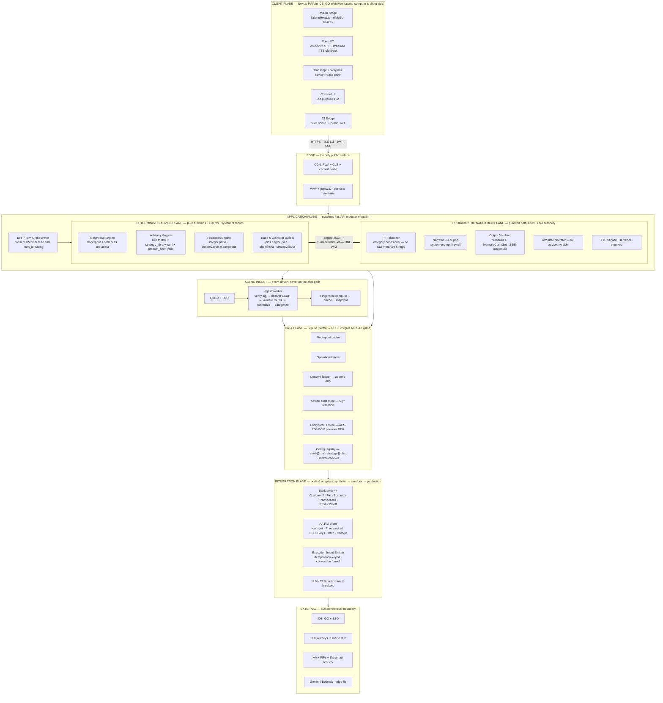

# DhanSaarthi — System Architecture

**DHS-ARCH-001 · v1.0 · 2026-07-12 · Status: approved for build**
IDBI Innovate 2026 · Track 01 — Wealth Advisory · Companion to [PRD.md](../PRD.md)

An avatar-fronted, Account-Aggregator-powered wealth advisory **sidecar** for IDBI Bank. A deterministic advisory engine computes every number; a firewalled LLM only narrates; the bank's existing rails execute. The ₹0 prototype and the production deployment are the same architecture at two different scales.

> Interactive version with the full container diagram, failure catalogue, and compliance mapping:
> https://claude.ai/code/artifact/0d4c432a-423a-4779-aff8-4ee37eed217f

---

## 0. The architecture in four invariants

Every design decision below derives from four invariants. If a future change violates one, the change is wrong — not the invariant.

1. **The determinism boundary.** The LLM never computes; the engine never speaks. Every rupee figure, allocation %, and projection is produced by a deterministic, unit-tested Python engine and travels with a `reasoning_trace` and a `NumericClaimSet`. An output validator rejects any LLM sentence containing a number outside that set.
2. **Sidecar, not rewrite.** All bank integration passes through four adapter ports plus an AA FIU client. Execution ("start SIP", "open FD") is emitted as idempotent deep-link intents into IDBI's existing journeys. Finacle is never touched; zero new transaction risk.
3. **Consent is the schema.** No datum exists without a live consent artefact behind it. FI data enters only via the RBI AA framework (signed consent artefact, end-to-end FIP→FIU encryption, data-blind AA relay, purpose-bound). Consent is checked at **read time**, not just fetch time; revocation triggers erasure (DPDP 2023).
4. **Graceful degradation, never failure.** LLM down → template narration. Neural TTS down → browser speech. WebGL weak → 2D portrait. AA partial → staleness-flagged advice. Advice-plane availability is independent of every third-party dependency.

---

## 1. System context (C4 L1)

**Trust gradient.** The customer's device is semi-trusted (renders, captures voice, holds a 5-minute JWT — never a bank credential). LLM providers are untrusted with identity (tokenized text only — never PII, never raw transactions). The AA ecosystem is cryptographically trusted: signatures verified against the Sahamati registry, payloads decrypted and schema-validated before a byte enters the engines.

---

## 2. Container view (C4 L2/L3)

Six planes; each crosses into the next through one named contract.

**Why a modular monolith:** the hot path is a 10 ms pure function; microservices would add network hops and operational surface for nothing. The seams to split along later are already drawn — they are the adapter ports.

---

## 3. Life of an advice turn (hot path)

Budget: **p95 ≤ 2.5 s to first spoken word**. Not on this path: AA calls, core-banking calls, any blocking LLM dependency.

| # | Lane | Step |
|---|------|------|
| 1 | Client | Customer speaks; Web Speech STT transcribes **on-device**. Only text crosses the wire (no voice-biometric liability). |
| 2 | Edge | `POST /turn` over TLS 1.3 with 5-min JWT; WAF + per-user rate limit. |
| 3 | BFF | Verify **consent still live**, read cached fingerprint. A revocation two minutes ago already blocks this turn. |
| 4 | Advice plane | Advisory Engine: fingerprint → strategy → allocation → products; Projection Engine runs goal math. Emits `recommendation + reasoning_trace + NumericClaimSet` in <10 ms, deterministic and replayable. |
| 5 | Narration | PII Tokenizer masks identity/amount slots; only category codes and pre-formatted figures remain. |
| 6 | Narration | Narrator streams EN/HI/Hinglish prose under the system-prompt firewall. First-token budget 800 ms; timeout trips template mode. |
| 7 | Narration | Output Validator extracts every numeral (₹, %, lakh/crore, years) → must be in the NumericClaimSet; SEBI disclosure appended in code, not prompt. Violation → one retry → template. Escape budget: **zero**. |
| 8 | Narration | PII rehydrated; sentence-chunked TTS streaming. |
| 9 | Client | SSE streams text + audio; TalkingHead lip-syncs; trace panel renders "Why this advice?". |
| 10 | Data | Turn persisted to audit store: fingerprint snapshot, trace, `engine_ver`, `shelf@sha`, `strategy@sha`, narration hash → bit-for-bit replay (SEBI 5-year test). |
| 11 | Integration | "Start SIP" tap → idempotency-keyed intent → deep-link into the existing IDBI journey. Conversion funnel instrumented here. |

---

## 4. Data & consent (AA cold path)

| Step | Lane | What happens |
|------|------|--------------|
| A | Client | Consent UI raises request: purpose `102` (wealth management), FI types `DEPOSIT · TERM_DEPOSIT · RECURRING_DEPOSIT · MUTUAL_FUNDS`, monthly frequency, 12-month expiry. |
| B | AA | Customer approves in their AA app; AA issues signed consent artefact (JWS), verified against the Sahamati registry. |
| C | Data | Artefact recorded in append-only consent ledger (who shared what, when, purpose, expiry, revocations). |
| D | Integration | FI request with ephemeral ECDH key material; each FIP encrypts with the derived session key; AA relays **without the ability to read**. |
| E | Ingest | Decrypt → validate ReBIT schema → normalize to canonical ledger (integer paise) → map merchants to a **closed category vocabulary**. Raw merchant descriptors are attacker-controlled text: quarantined, never reach an LLM prompt. |
| F | Data | Fingerprint computed and cached; raw payload sealed under per-user data key. Partial FIP responses → field-level staleness flags; the engine softens claims accordingly. |

### Stores, protection, retention

| Store | Contents | Protection | Retention / erasure |
|---|---|---|---|
| Encrypted FI store | raw AA payloads, canonical ledger | AES-256-GCM, per-user DEK under KMS envelope | consent-life; hard-erased on revocation (DPDP) |
| Consent ledger | artefacts, scopes, revocations | append-only, hash-chained | 7 years |
| Advice audit store | per-turn snapshot: fingerprint, trace, versions, narration hash | append-only; PII tokenized | 5 years (SEBI AI/ML norms) |
| Fingerprint cache | derived features only | TTL ≤ 30 days + event invalidation | evicted with consent |
| Operational store | users, sessions, goals, intents | column-level PII encryption | account life; DPDP erasure endpoint |
| Config registry | product shelf, strategy library YAML | GitOps, maker-checker, content-addressed | immutable history |

---

## 5. The determinism boundary, in depth

The engine is the system of record; the LLM is a rendering layer for prose — structurally a template engine that happens to be eloquent.

- **Compliance:** SEBI's 2025 AI/ML framework (Reg 16C + five pillars) demands governance, explainability, audit. Our advice "model" is a rule matrix with a printed trace; the probabilistic component demonstrably cannot alter a recommendation.
- **Testing:** five synthetic personas × strategy library = golden advice fixtures in CI. A rate change in `product_shelf.yaml` is a failing test diff, reviewed like code.
- **Economics:** template mode is the same advice minus warmth — the LLM is a cost lever, not a dependency.

| Direction | Payload | Guard |
|---|---|---|
| engine → narrator | recommendation JSON · trace · NumericClaimSet (pre-formatted ₹/%/tenor strings) · category codes | PII tokenized; closed vocabulary; LLM never formats currency |
| narrator → client | validated prose + SEBI disclosure footer | numeral-membership check; off-topic deflection; disclosure injected in code |
| narrator → engine | **nothing** | no API exists for it |
| user free text → prompts | intent classification only | raw user text reduced to an intent enum; merchant strings quarantined |

---

## 6. Graceful-degradation ladder

| Level | Mode | Trigger |
|---|---|---|
| L0 | 3D avatar · streamed LLM · neural TTS | golden path |
| L1 | Template narration from reasoning_trace — identical advice, plainer prose | LLM timeout (800 ms first token), quota, validator double-failure; fallback < 200 ms |
| L2 | Browser SpeechSynthesis voices | TTS circuit breaker open |
| L3 | 2D portrait + captions + audio | WebGL probe fails / WebView memory pressure |
| L4 | Declared-data mode (goals + stated income, labeled non-verified) | consent absent, expired, or revoked |

---

## 7. Deployment — one architecture, two scales

| Concern | Prototype (₹0, July 13) | Production (IDBI AWS) | Seam |
|---|---|---|---|
| Frontend | Next.js dev / Vercel free | S3 + CloudFront behind WAF, IDBI GO WebView | static asset — none |
| API + engines | uvicorn on laptop | ECS Fargate ×2 AZ, ALB, autoscale on p95 | stateless by design |
| LLM | Gemini Flash free tier | Bedrock in-VPC endpoint | LLM port + golden-transcript contract tests |
| TTS | edge-tts | Polly / in-region neural TTS | TTS port |
| Database | SQLite | RDS Postgres Multi-AZ, PITR | same logical schema |
| Cache | in-process dict | ElastiCache Redis | cache interface |
| Events | synchronous ingest | EventBridge + SQS + DLQ | ingest trigger port |
| AA data | synthetic generator emitting ReBIT FI-JSON | Sahamati-certified FIU module + AA partner | AA client — schema identical from day 1 |
| Secrets | `.env` (gitignored) | Secrets Manager + KMS | config provider |
| Observability | structured stdout | CloudWatch + OTel (turn_id spans STT→TTS) + PII-canary scanner | logging adapter |

**Capacity envelope:** 10 M users × 2 sessions/mo × 6 turns ≈ 46 turns/s average, ~450/s peak. Engine cost per turn <10 ms CPU on ~1 KB JSON → tens of Fargate tasks. Avatar rendering is the customer's GPU. The only per-turn variable cost is LLM inference — and L1 makes it discretionary. AA fetches are per-consent-per-month, not per-message.

---

## 8. Production failure catalogue

| Failure / discrepancy | Designed mitigation |
|---|---|
| LLM emits a number the engine never produced | Validator numeral-membership gate → retry once → template mode. Hard gate; escapes alarmed as sev-1. |
| Prompt injection via merchant descriptors (attacker-controlled strings in UPI narrations) | Quarantined at ingest; only closed-vocabulary category codes enter prompts; user text reduced to intent enum. |
| Gemini/Bedrock throttled or down mid-conversation | 800 ms first-token timeout, circuit breaker, L1 templates; pre-cached golden-path audio for the demo. |
| Partial AA data (one FIP times out) | Per-field staleness + confidence; engine downgrades claims; no silent imputation. |
| Consent revoked mid-session | Consent checked at read time each turn; revocation event → cache eviction + FI erasure; session falls to L4. |
| Double-tap on "Start SIP" | Client idempotency key per tap-intent; emitter dedupes; exactly-once at the port. |
| Float drift (₹19,00,000 vs ₹18,99,999.87 between voice and trace panel) | Integer paise everywhere; lakh/crore formatting once, in the engine; LLM receives final strings. |
| Stale product shelf (FD rate changed this morning) | Versioned config + maker-checker; `shelf@sha` pinned in every trace; staleness TTL alarm; CI fixtures re-verified on change. |
| SSO nonce replay via JS bridge | One-time nonce, audience-bound 5-min JWT, server replay cache, CORS locked to WebView origin. |
| Low-end Android WebView OOM / no WebGL | Capability probe before GLB load; draco LOD assets; L3 fallback; ≤150 MB memory budget on reference devices. |
| Clock skew on consent expiry | Server time authoritative; negative margin; artefact re-validated at every FI request. |
| PII leaking into logs/traces | Schema-checked structured logging; PII-canary regex scanner in CI and on the log pipeline. |
| Provider migration skew (Gemini → Bedrock drift) | LLM port with golden-transcript contract tests; validator invariants provider-independent; cohort canary rollout. |
| Fingerprint stale after salary credit | Event-driven invalidation + max-age TTL; staleness stated honestly in narration. |
| Panic-exit conversations in a market crash | Cycle-aware guardrails (Marks rules): panic intents route to goal math + Future Self, never to exit deep-links; load-shed protects the advice plane. |

---

## 9. Service-level objectives

| SLO | Target | Notes |
|---|---|---|
| First spoken word | p95 ≤ 2.5 s | engine 10 ms · LLM first token 800 ms · TTS first chunk 600 ms · rest network/render |
| Engine compute | p99 ≤ 10 ms | pure function over cached fingerprint |
| Advice-plane availability | 99.9% | measured with LLM forced off — L1 counts as available |
| Full-mode (L0) availability | 99.5% | bounded by third parties; degradation, not outage |
| Numeric-guardrail escape rate | 0 | hard gate; any escape is sev-1 with audit replay |
| Avatar frame rate | ≥ 30 fps | reference mid-tier Android; ≤ 150 MB WebView memory |
| Ingest freshness | ≤ 24 h | consent grant → first fingerprint; monthly refresh after |
| Erasure completion (DPDP) | ≤ 72 h | revocation → FI store + cache purge |

**The bank's metric:** the funnel at the Execution Intent Emitter — sessions → recommendations → traces opened → intents fired → journeys completed. Idle-cash activated and SIP conversion computed here (Vanguard Advisor's-Alpha framing, ~3%/yr advisory value).

---

## 10. Compliance mapping

| Obligation | Instrument | Architectural control |
|---|---|---|
| Sole liability for AI tools | SEBI Intermediaries (Amendment) Regs 2025, Reg 16C | Determinism boundary caps what AI can do; validator + audit store evidence it continuously. |
| Model governance, interpretability, testing | SEBI Responsible AI/ML guidelines (June 2025, five pillars) | Rule-matrix "model" with printed trace; CI golden fixtures per persona; `docs/model-card.md`; periodic accuracy reporting from the audit store. |
| Investor disclosure | SEBI AI/ML guidelines · IA conduct norms | Disclosure footer injected in code on every response; trace exposed in-UI; AI usage disclosed at onboarding. |
| 5-year record retention | SEBI AI/ML consultation norms | Append-only audit store with pinned versions — bit-for-bit replay. |
| Consent-based access, purpose limitation | RBI Master Direction — NBFC-AA | AA-only ingestion; purpose 102 binding; consent ledger; re-check at read time. |
| Consent withdrawal & erasure | DPDP Act 2023 | Revocation endpoint → erasure pipeline (≤72 h); per-user envelope keys enable crypto-erasure. |
| Data security | DPDP · CERT-In · RBI outsourcing norms | TLS 1.3, AES-256-GCM, KMS envelope, least-privilege roles, PII-canary scanning, in-VPC LLM in production. |
| Advice-vs-distribution perimeter | SEBI IA Regulations · bank distribution permissions | Prototype scoped to guidance + IDBI-shelf distribution; full RIA registration is an explicit future-scope module. |

---

## 11. Decisions — and deliberate non-decisions

**Decided**
- **Modular monolith first.** One FastAPI deployable with enforced internal boundaries (the ports). Split into services only when scale demands; the seams are already drawn.
- **Client-side avatar rendering.** Server-side avatar video costs GPU-seconds per user-second; WebGL on-device costs the bank ~nothing at the margin. Fallback ladder absorbs weak devices.
- **Config as product.** Strategies and the product shelf are versioned YAML behind maker-checker — a rate change or new manager playbook is a config diff with CI fixtures, not a deploy.
- **Code against the ReBIT schema from day 1.** Synthetic generator emits real AA FI-JSON; swapping to IDBI's sandbox is one adapter.

**Rejected**
- **No fine-tuned or agentic LLM.** Fine-tuning adds SEBI model-governance burden for zero advice-quality gain; agentic tool-calling would puncture the determinism boundary. Revisit only under the future-scope mandate framework.
- **No direct core-banking writes. No stock tips. No optimistic math.** Execution stays on IDBI's rails; stock-picking strategies excluded from the library; projections use conservative assumptions (10% equity / 6.5% debt nominal) — Graham's margin of safety, encoded.

---

## References

- [SEBI — Consultation Paper: Responsible Usage of AI/ML in Indian Securities Markets (June 2025)](https://www.sebi.gov.in/reports-and-statistics/reports/jun-2025/consultation-paper-on-guidelines-for-responsible-usage-of-ai-ml-in-indian-securities-markets_94687.html)
- [SEBI Intermediaries (Amendment) Regulations 2025 — Regulation 16C](https://www.scconline.com/blog/post/2025/02/11/sebi-introduces-concept-of-ai/)
- [RBI — Regulatory framework for Account Aggregators](https://www.bis.org/review/r210916e.htm)
- [AA framework explainer — consent artefact, data-blind relay, FIP/FIU roles](https://internetfreedom.in/explainer-account-aggregator-framework-saveourprivacy/)
- [AA framework — ReBIT technical specifications & Sahamati interoperability](https://hyperverge.co/blog/account-aggregator-framework-rbi/)
